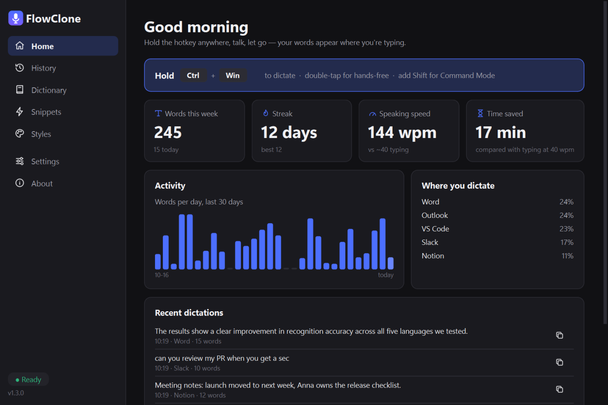
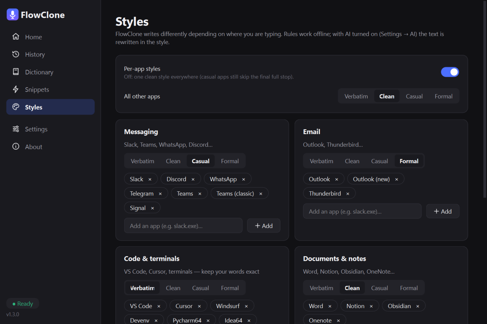
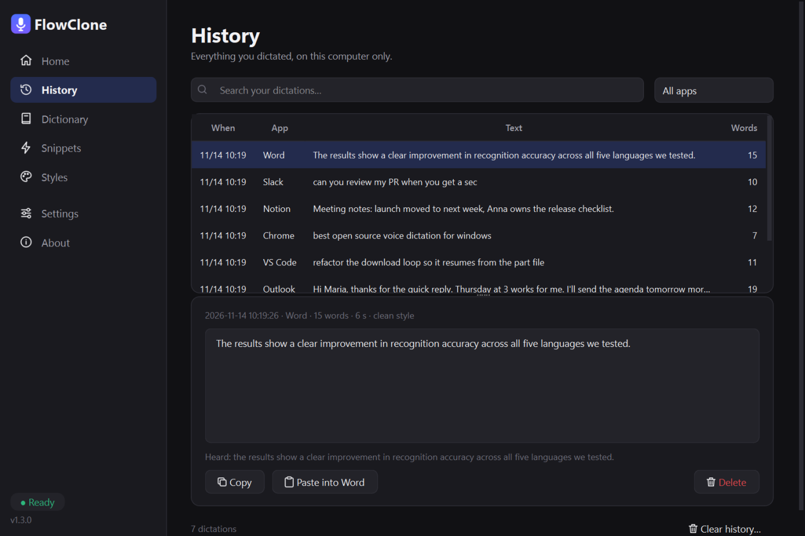
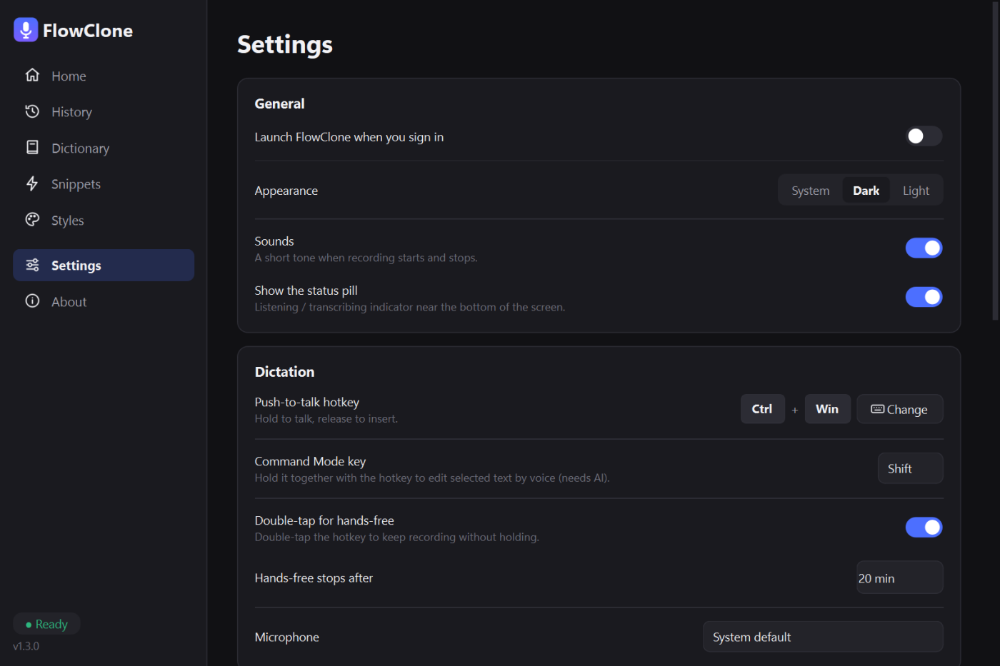
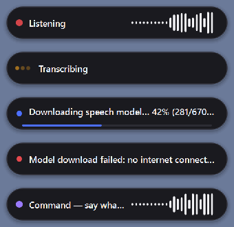
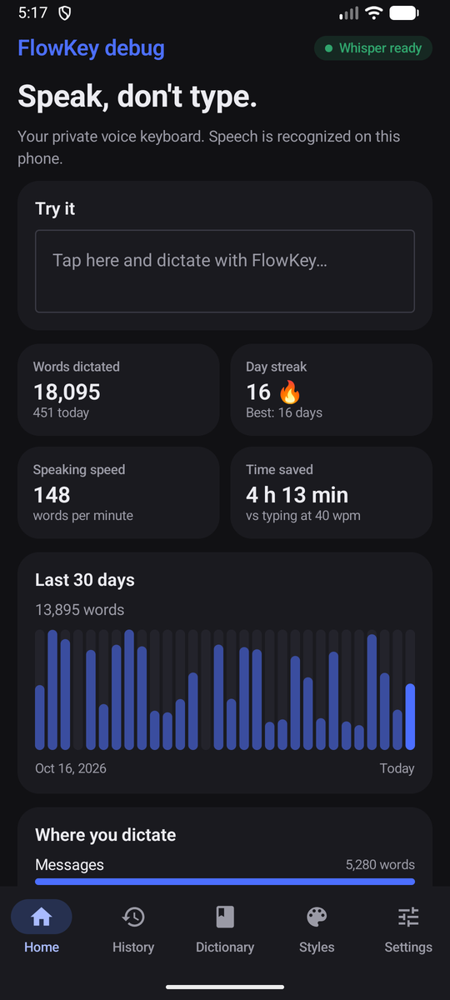
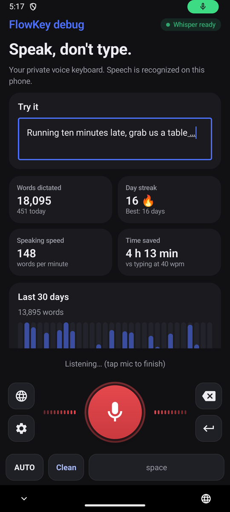
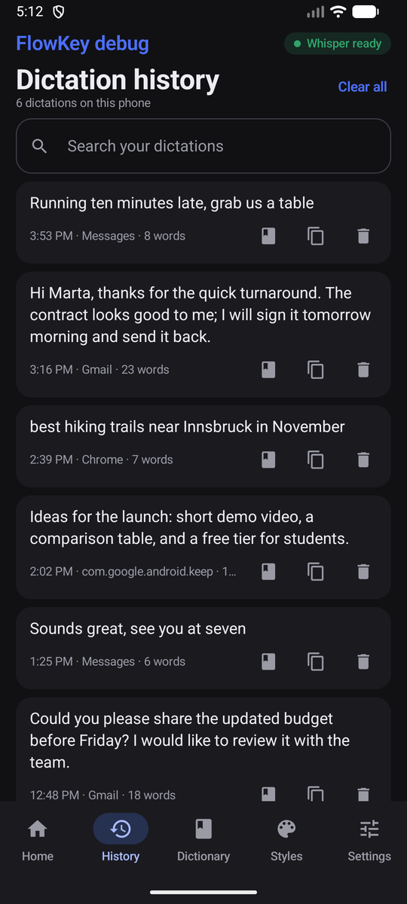
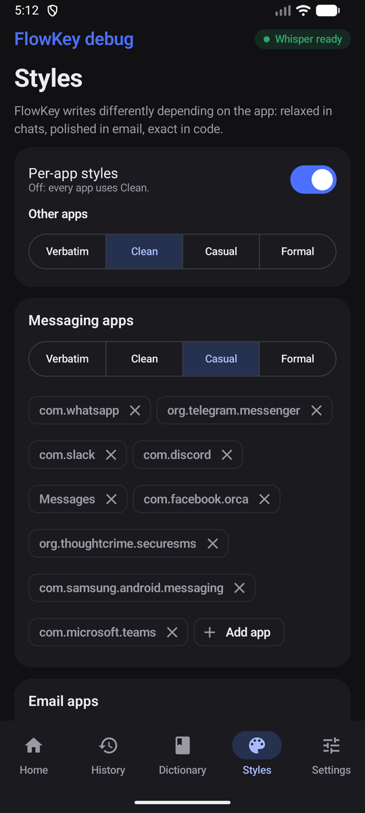
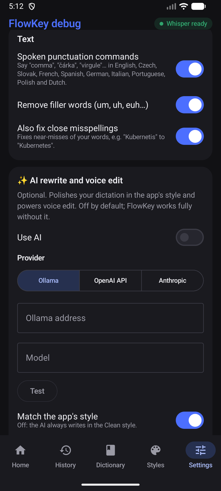

<p align="center">
  
</p>

<p align="center">
  <a href="https://github.com/stepan4002/flow-clone/actions/workflows/ci.yml"></a>
  <a href="LICENSE"></a>
  
  
  
</p>

<p align="center">
  <b>Hold a key, speak, release — polished text appears in any app.</b><br>
  Speech recognition on your device. No account. No subscription. No word limits. Your voice never leaves your computer or phone.
</p>

<p align="center">
  
</p>

---

## ⚡ Install in one line

**Windows 10/11** — download and run
**[FlowClone-Setup.exe](https://github.com/stepan4002/flow-clone/releases/latest/download/FlowClone-Setup.exe)**
(~48 MB, no admin rights, no Python needed). A one-minute setup shows you around while the
speech model downloads once (~670 MB). Then hold **Ctrl + Win**, speak, release.

<sub>The installer isn't code-signed yet, so Windows may say *“Windows protected your PC”*:
click **More info → Run anyway**. You can check the download against the
`FlowClone-Setup.exe.sha256` file published with each release.</sub>

Prefer a script? Open PowerShell and paste:

```powershell
irm https://raw.githubusercontent.com/stepan4002/flow-clone/main/install.ps1 | iex
```

**Android 8+** — open this link on your phone and install:
**[FlowKey.apk](https://github.com/stepan4002/flow-clone/releases/latest/download/FlowKey.apk)** (speech models included, ~270 MB)

<sub>Prefer to read before you run? See <a href="install.ps1"><code>install.ps1</code></a> — it installs per-user into <code>%LOCALAPPDATA%\FlowClone</code>, needs no admin rights, and is easy to <a href="#uninstall">uninstall</a>.</sub>

---

## ✨ Features

<p align="center">
  
  
  
  
</p>
<p align="center"></p>

<p align="center">
  
  
  
  
  
</p>

| | Windows — **FlowClone** | Android — **FlowKey** |
|---|---|---|
| Dictate into **any app** | Push-to-talk **Ctrl+Win** (or double-tap for hands-free) | Voice keyboard (IME): tap the mic |
| Speech engine | NVIDIA **Parakeet-TDT 0.6B v3** (or Whisper) | Multilingual **Whisper** via sherpa-onnx |
| Languages | **EN · CS · FR · ES** + 21 more, auto-detected | **99 languages** — EN · CS · FR · ES preset, add any other in Setup |
| Live text | — (push-to-talk, text appears on release) | words appear **while you speak**, in every language |
| Cleanup | fillers, spoken punctuation, *“scratch that”*, capitalization, *“press enter”* | fillers, spoken punctuation in **10 languages**, *“scratch that”*, smart spacing |
| **Styles per app** | verbatim in code, casual in chat, formal in email — rules offline, AI-rewritten when enabled | ✅ the same, plus a style key on the keyboard |
| **Command Mode** | select text, hold **Ctrl+Win+Shift**, say *“make this shorter”* (needs AI) | **Voice edit**: select text, tap ✨ Edit or long-press the mic (needs AI) |
| AI rewrite (optional) | local **Ollama**, or your own key for any OpenAI-compatible API or Anthropic | the same (Ollama on your network); key encrypted with the Android Keystore |
| Insights | words per day, streak, speaking speed, time saved, top apps | ✅ the same |
| Personal dictionary & snippets | ✅ | ✅ + **“Your words”**: names and jargon spelled your way and boosted in recognition |
| History | ✅ searchable, paste again, delete + paste-last / copy-last hotkeys | ✅ searchable (1000), copy, delete, **Undo** chip right after dictating |
| Network access | to download the model once — and to your AI provider only if you pick a cloud one | only for the optional higher-accuracy model download — and your AI provider if you turn AI on |

## 🔒 Privacy

- Audio is recorded, transcribed and cleaned **on your device**. There is no FlowClone server, no telemetry, no analytics.
- Android: speech is recognized entirely on the phone; audio never leaves it. The `INTERNET` permission is used for two things you turn on yourself: the optional higher-accuracy model, downloaded from Hugging Face when *you* tap Download (fixed HTTPS URLs, checksum-verified), and the optional AI rewrite — your own Ollama on your network, or a cloud API with your own key, which then receives the **text** of your dictations (never audio). Keys are encrypted with the Android Keystore and never backed up; password and incognito fields never use AI and are never stored. No analytics, no accounts.
- Windows: the only network calls are the one-time speech-model download from Hugging Face (pinned to an exact model version and checked with SHA-256, saved in `%LOCALAPPDATA%\FlowClone\models`) and — only if you turn on AI rewrite — calls to the AI provider *you* choose: your own Ollama on `localhost` (stays on the PC), or a cloud API with your own key, which then receives the **text** of your dictations (never audio). API keys are kept in Windows Credential Manager.
- Your settings, dictionary and history stay in `%APPDATA%\FlowClone` (Windows) or the app's private storage (Android).

## 🧠 How it works

```
hold hotkey ─► mic (16 kHz) ─► local speech-to-text ─► style rules ─► (optional) AI rewrite ─► paste into focused app
                               Parakeet / Whisper       per app:           Ollama, or your own       clipboard-save → Ctrl+V
                               int8 ONNX on CPU         verbatim/clean/    OpenAI-compatible /       → clipboard-restore
                                                        casual/formal      Anthropic key
```

Parakeet-TDT 0.6B v3 scores **6.3 % WER** (better than Whisper large-v3's 7.4 %) and runs **50–100× real-time on a plain CPU** — a 5-second sentence is transcribed in roughly 0.1–0.3 s. No GPU needed. The research behind these choices is in [`docs/research/`](docs/research/).

## 🆚 Compared with Wispr Flow

FlowClone recreates the core Wispr Flow workflow with local models. It is an independent project.

| | Wispr Flow | FlowClone |
|---|---|---|
| Price | free tier 2,000 words/week, then subscription | **$0, unlimited** |
| Works offline | ❌ cloud only | ✅ |
| Your audio leaves the device | yes (cloud ASR + LLMs) | **never** |
| Languages | 100+ | 25 (Parakeet) / 90+ (Whisper mode) |
| Styles per app, self-corrections | ✅ cloud LLM | ✅ rules offline; AI via local Ollama or your own key |
| Command mode / voice editing | ✅ | ✅ (needs AI: local or your own key) |
| Insights, streaks, searchable history | ✅ | ✅ |
| macOS / iOS | ✅ | not yet |

## 📁 Repository layout

| Folder | What |
|---|---|
| [`windows/`](windows/) | Python + Qt desktop app (home, history, dictionary, snippets, styles, settings) and the installer. [Full guide →](windows/README.md) |
| [`android/`](android/) | Kotlin voice-keyboard IME. [Build & usage guide →](android/README.md) · [models →](android/MODELS.md) |
| [`docs/research/`](docs/research/) | Feature spec and the local speech-to-text engine comparison |
| [`install.ps1`](install.ps1) · [`scripts/`](scripts/) | One-line installers |

## 🛠️ Build from source

**Windows** (Python 3.10–3.12):

```powershell
git clone https://github.com/stepan4002/flow-clone.git
cd flow-clone\windows
pip install -r requirements.txt
python run.py
```

To build `FlowClone.exe` and the installer: Python 3.12, `pip install -r requirements-build.txt`,
then `build_exe.bat` and `build_installer.bat` (Inno Setup 6). Releases: see
[RELEASING.md](RELEASING.md).

**Android** (JDK 17+, Android SDK):

```bash
cd flow-clone/android
./fetch-deps.sh          # sherpa-onnx AAR (add --model to bundle the speech models)
./gradlew assembleDebug
```

Run the tests with `python -m pytest windows/tests`.

## Uninstall

**Windows (FlowClone-Setup.exe):** Settings → Apps → FlowClone → Uninstall. It asks whether
to also remove your settings, history and the downloaded speech model.

**Windows (script install):**

```powershell
$env:FLOWCLONE_UNINSTALL='1'; irm https://raw.githubusercontent.com/stepan4002/flow-clone/main/install.ps1 | iex; Remove-Item Env:FLOWCLONE_UNINSTALL
```

This removes the app, the Start-menu shortcut and the autostart entry (and the speech model,
unless FlowClone.exe is also installed). Delete `%APPDATA%\FlowClone` too if you also want
your settings and history gone.

**Android:** long-press FlowKey → Uninstall.

## 🗺️ Roadmap

- [x] Command mode — select text, say *“make this more formal”* (Windows)
- [x] New Windows app: insights, searchable history, styles per app, onboarding
- [x] Android: the same design, insights, styles, AI rewrite and voice edit
- [x] Standalone `FlowClone.exe` installer
- [ ] Code signing for the Windows installer
- [x] Spoken punctuation commands in Czech, French, Spanish and 6 more languages (Android)
- [ ] macOS port
- [x] Android: live text in every language
- [ ] Android: Parakeet engine

Ideas and pull requests are welcome — see [CONTRIBUTING.md](CONTRIBUTING.md).

## 🙏 Credits & licenses

FlowClone is [MIT-licensed](LICENSE). It stands on these projects, which keep their own licenses:
[NVIDIA Parakeet-TDT-0.6B-v3](https://huggingface.co/nvidia/parakeet-tdt-0.6b-v3) (CC-BY-4.0) ·
[OpenAI Whisper](https://github.com/openai/whisper) (MIT) ·
[sherpa-onnx](https://github.com/k2-fsa/sherpa-onnx) (Apache-2.0) ·
[onnx-asr](https://github.com/istupakov/onnx-asr) (MIT) ·
[faster-whisper](https://github.com/SYSTRAN/faster-whisper) (MIT) ·
[Ollama](https://ollama.com) / Qwen3 (Apache-2.0) ·
[Qt 6 / PySide6](https://www.qt.io/qt-for-python) (LGPL-3.0).

<sub>FlowClone is an independent open-source project. It is not affiliated with, endorsed by, or sponsored by Wispr, Inc. “Wispr Flow” is a trademark of its owner and is used here only to describe compatibility of the workflow.</sub>
