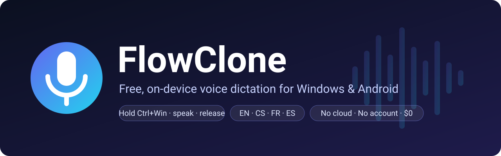

<p align="center">
  
</p>

<p align="center">
  <a href="https://github.com/stepan4002/flow-clone/actions/workflows/ci.yml"></a>
  <a href="LICENSE"></a>
  
  
  
</p>

<p align="center">
  <b>Hold a key, speak, release — polished text appears in any app.</b><br>
  No cloud. No account. No subscription. No word limits. Nothing you say ever leaves your device.
</p>

<p align="center">
  
</p>

---

## ⚡ Install in one line

**Windows 10/11** — open PowerShell and paste:

```powershell
irm https://raw.githubusercontent.com/stepan4002/flow-clone/main/install.ps1 | iex
```

Then hold **Ctrl + Win**, speak, release. (First start downloads the ~330 MB speech model once.)

**Android 8+** — open this link on your phone and install:
**[FlowKey.apk](https://github.com/stepan4002/flow-clone/releases/latest/download/FlowKey.apk)** (speech models included, ~270 MB)

<sub>Prefer to read before you run? See <a href="install.ps1"><code>install.ps1</code></a> — it installs per-user into <code>%LOCALAPPDATA%\FlowClone</code>, needs no admin rights, and is easy to <a href="#uninstall">uninstall</a>.</sub>

---

## ✨ Features

| | Windows — **FlowClone** | Android — **FlowKey** |
|---|---|---|
| Dictate into **any app** | Push-to-talk **Ctrl+Win** (or double-tap for hands-free) | Voice keyboard (IME): tap the mic |
| Speech engine | NVIDIA **Parakeet-TDT 0.6B v3** (or Whisper) | Multilingual **Whisper** via sherpa-onnx |
| Languages | **EN · CS · FR · ES** + 21 more, auto-detected | **99 languages** — EN · CS · FR · ES preset, add any other in Setup |
| Live text | — (push-to-talk, text appears on release) | words appear **while you speak**, in every language |
| Cleanup | fillers, spoken punctuation, *“scratch that”*, capitalization, *“press enter”* | fillers, spoken punctuation in **10 languages**, *“scratch that”*, smart spacing |
| AI polish (optional, local) | self-corrections & per-app tone via **Ollama** | — |
| Personal dictionary & snippets | ✅ | ✅ + **“Your words”**: names and jargon spelled your way and boosted in recognition |
| History | ✅ + paste-last / copy-last hotkeys | ✅ last 50 |
| Network access | only to download the model once | only if you tap **Download** for the optional higher-accuracy model |

## 🔒 Privacy

- Audio is recorded, transcribed and cleaned **on your device**. There is no server, no telemetry, no analytics.
- Android: speech is recognized entirely on the phone; audio never leaves it. The `INTERNET` permission is used for one thing only — the optional higher-accuracy model, downloaded from Hugging Face when *you* tap Download in Setup (fixed HTTPS URLs, checksum-verified). No analytics, no accounts.
- Windows: the only network calls are the one-time model download from Hugging Face and — only if you enable it — `localhost` calls to your own Ollama.
- Your settings, dictionary and history stay in `%APPDATA%\FlowClone` (Windows) or the app's private storage (Android).

## 🧠 How it works

```
hold hotkey ─► mic (16 kHz) ─► local speech-to-text ─► rule cleanup ─► (optional) local LLM polish ─► paste into focused app
                               Parakeet / Whisper       fillers,          Ollama qwen3:1.7b              clipboard-save → Ctrl+V
                               int8 ONNX on CPU         punctuation…      self-corrections, tone         → clipboard-restore
```

Parakeet-TDT 0.6B v3 scores **6.3 % WER** (better than Whisper large-v3's 7.4 %) and runs **50–100× real-time on a plain CPU** — a 5-second sentence is transcribed in roughly 0.1–0.3 s. No GPU needed. The research behind these choices is in [`docs/research/`](docs/research/).

## 🆚 Compared with Wispr Flow

FlowClone recreates the core Wispr Flow workflow with local models. It is an independent project.

| | Wispr Flow | FlowClone |
|---|---|---|
| Price | free tier 2,000 words/week, then subscription | **$0, unlimited** |
| Works offline | ❌ cloud only | ✅ |
| Your audio leaves the device | yes (cloud ASR + LLMs) | **never** |
| Languages | 100+ | 25 (Parakeet) / 90+ (Whisper mode) |
| Restatement self-correction, tone | ✅ cloud LLM | ✅ with optional local Ollama |
| Command mode / voice editing | ✅ | roadmap |
| macOS / iOS | ✅ | not yet |

## 📁 Repository layout

| Folder | What |
|---|---|
| [`windows/`](windows/) | Python tray app + Hub (settings, dictionary, snippets, history). [Full guide →](windows/README.md) |
| [`android/`](android/) | Kotlin voice-keyboard IME. [Build & usage guide →](android/README.md) · [models →](android/MODELS.md) |
| [`docs/research/`](docs/research/) | Feature spec and the local speech-to-text engine comparison |
| [`install.ps1`](install.ps1) · [`scripts/`](scripts/) | One-line installers |

## 🛠️ Build from source

**Windows** (Python 3.10–3.12):

```powershell
git clone https://github.com/stepan4002/flow-clone.git
cd flow-clone\windows
pip install -r requirements.txt
python run.py
```

**Android** (JDK 17+, Android SDK):

```bash
cd flow-clone/android
./fetch-deps.sh          # sherpa-onnx AAR (add --model to bundle the speech models)
./gradlew assembleDebug
```

Run the tests with `python -m pytest windows/tests`.

## Uninstall

**Windows:**

```powershell
$env:FLOWCLONE_UNINSTALL='1'; irm https://raw.githubusercontent.com/stepan4002/flow-clone/main/install.ps1 | iex; Remove-Item Env:FLOWCLONE_UNINSTALL
```

This removes the app, the Start-menu shortcut and the autostart entry. Delete `%APPDATA%\FlowClone` too if you also want your settings and history gone.

**Android:** long-press FlowKey → Uninstall.

## 🗺️ Roadmap

- [ ] Command mode — select text, say *“make this more formal”*
- [ ] Signed standalone `FlowClone.exe` installer
- [x] Spoken punctuation commands in Czech, French, Spanish and 6 more languages (Android)
- [ ] macOS port
- [x] Android: live text in every language
- [ ] Android: Parakeet engine

Ideas and pull requests are welcome — see [CONTRIBUTING.md](CONTRIBUTING.md).

## 🙏 Credits & licenses

FlowClone is [MIT-licensed](LICENSE). It stands on these projects, which keep their own licenses:
[NVIDIA Parakeet-TDT-0.6B-v3](https://huggingface.co/nvidia/parakeet-tdt-0.6b-v3) (CC-BY-4.0) ·
[OpenAI Whisper](https://github.com/openai/whisper) (MIT) ·
[sherpa-onnx](https://github.com/k2-fsa/sherpa-onnx) (Apache-2.0) ·
[onnx-asr](https://github.com/istupakov/onnx-asr) (MIT) ·
[faster-whisper](https://github.com/SYSTRAN/faster-whisper) (MIT) ·
[Ollama](https://ollama.com) / Qwen3 (Apache-2.0).

<sub>FlowClone is an independent open-source project. It is not affiliated with, endorsed by, or sponsored by Wispr, Inc. “Wispr Flow” is a trademark of its owner and is used here only to describe compatibility of the workflow.</sub>
