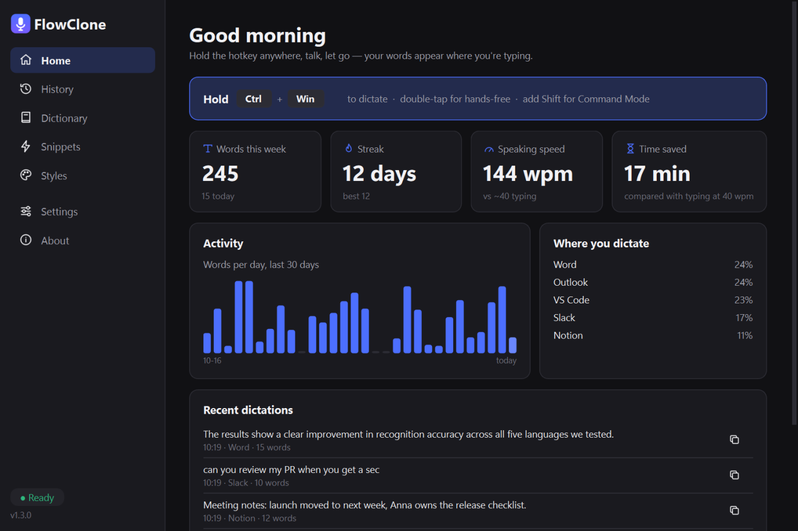
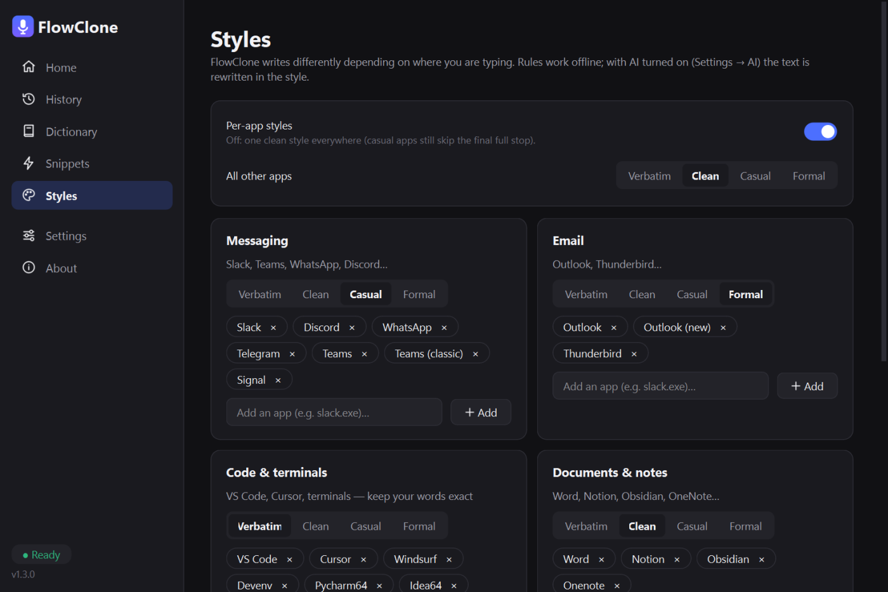

# FlowClone for Windows — free, local voice dictation

Hold **Ctrl+Win**, speak, release — polished text appears at your cursor in **any app**
(browser, Slack, VS Code, terminal, Word...). Speech recognition runs on your laptop: no
account, no subscription, no word limits, works offline.

**Languages: English, Czech, French, Spanish** (and 21 more European languages) are
supported out of the box with automatic per-utterance language detection — just speak;
no switching needed.



## How it works

```
hold hotkey → mic capture (sounddevice, 16 kHz)
→ local speech-to-text (NVIDIA Parakeet-TDT-0.6B-v3, int8 ONNX — beats Whisper
  large-v3 accuracy, ~50-100x real-time on CPU, no GPU needed)
→ your dictionary, corrections and snippets
→ the app's style: verbatim / clean / casual / formal (fillers, spoken punctuation,
  "scratch that", capitalization, chat-style endings)
→ optional AI rewrite: local Ollama, or your own OpenAI-compatible / Anthropic key
→ clipboard-save → Ctrl+V paste → clipboard-restore  (the same trick Wispr Flow uses)
```

## Install (5 minutes)

**Installer (recommended):** download
[FlowClone-Setup.exe](https://github.com/stepan4002/flow-clone/releases/latest/download/FlowClone-Setup.exe)
and run it. No admin rights and no Python needed; it installs into
`%LOCALAPPDATA%\Programs\FlowClone`, adds a Start-menu entry and can start FlowClone when you
sign in. A one-minute setup checks your microphone and lets you try a first dictation while
the speech model downloads. It isn't code-signed yet: if Windows says *"Windows protected your
PC"*, click **More info → Run anyway**.

**One line** (PowerShell, no admin needed). This installs into `%LOCALAPPDATA%\FlowClone`,
creates a Start-menu shortcut and launches the app:

```powershell
irm https://raw.githubusercontent.com/stepan4002/flow-clone/main/install.ps1 | iex
```

**Manual install from a clone of this repo:**

1. Install **Python 3.10–3.12** from https://python.org (check "Add to PATH").
2. In this folder:
   ```
   pip install -r requirements.txt
   ```
3. Run it — double-click **`FlowClone.bat`** (no console window), or:
   ```
   python run.py
   ```
   First run downloads the speech model (~670 MB, one time) into
   `%LOCALAPPDATA%\FlowClone\models`, with the progress shown on the status pill and in the
   app. If an earlier FlowClone already downloaded it into the Hugging Face cache
   (`~/.cache/huggingface`), it is reused instantly (hardlinked, no extra disk space).

**Offline / blocked network:** download the four files `encoder-model.int8.onnx`,
`decoder_joint-model.int8.onnx`, `vocab.txt` and `config.json` from
[istupakov/parakeet-tdt-0.6b-v3-onnx](https://huggingface.co/istupakov/parakeet-tdt-0.6b-v3-onnx)
into `%LOCALAPPDATA%\FlowClone\models\parakeet-tdt-0.6b-v3-int8\` and start FlowClone; they
are checked once and used.

## Build FlowClone.exe and the installer

Python 3.12, from this folder:

```bat
pip install -r requirements-build.txt
build_exe.bat          & rem -> dist\FlowClone\FlowClone.exe, then runs its self-test
build_installer.bat    & rem -> installer\Output\FlowClone-Setup.exe (needs Inno Setup 6)
```

`FlowClone.spec` is the PyInstaller definition and `requirements-build.txt` pins every
version. The exe contains the Parakeet engine only; the Whisper engine (faster-whisper)
stays available in the script install. `FlowClone.exe --selftest` checks a build (it builds the
window offscreen, in a temporary profile) and writes `%TEMP%\FlowClone-selftest.log`. Releases
are built by GitHub Actions (see [../RELEASING.md](../RELEASING.md)). Dev tools:
`pip install -r requirements-dev.txt`, then `python tools/make_icon.py` (icons) and
`python tools/screenshots.py OUT_DIR both` (every page with demo data).

## Usage

| Action | How |
|---|---|
| Dictate | **Hold Ctrl+Win**, speak, release |
| Hands-free mode (no holding) | **Double-tap Ctrl+Win** (tap again or Esc to stop; 20-min cap) |
| **Command Mode** | select text, **hold Ctrl+Win+Shift**, say *"make this shorter"* / *"translate to German"*; with nothing selected it writes what you ask for (needs AI) |
| Cancel a dictation | **Esc** while recording |
| Paste last transcript again | **Shift+Alt+Z** |
| Copy last transcript | **Shift+Alt+X** |
| Say **"press enter"** at the end | auto-sends the message after inserting |
| Say **"scratch that"** | deletes everything you said before it in this dictation |
| Spoken punctuation | "period", "comma", "question mark", "new line", "new paragraph"… |
| Open FlowClone | Start menu, or click the tray icon (on Windows 11 it may be under ^) |

## The app

- **Home** — words this week, streak, speaking speed, time saved compared with typing, a
  30-day activity chart, the apps you dictate into most, and recent dictations.
- **History** — search everything you dictated, filter by app, see what was heard, copy it,
  paste it into the app again, or delete it.
- **Dictionary** — your words (spelled and capitalised your way), corrections for misheard
  words ("Eric" → "Erik") and replacements (say something short, insert something long).
- **Snippets** — say a trigger phrase anywhere in a sentence and the full text is inserted.
- **Styles** — how text is written in each kind of app: **Messaging** (casual), **Email**
  (formal), **Code & terminals** (verbatim — exactly what you said), **Documents** (clean),
  plus a default for every other app. Add or move apps between categories, and preview a
  sentence in each style.
- **Settings** — launch at sign-in, theme, sounds, the status pill, the hotkey (press the keys
  to record it), the Command Mode key, hands-free, microphone, text rules, AI rewrite, and the
  speech model. Changes save immediately; a new hotkey needs a restart (one click).



## AI rewrite (optional)

Off by default; FlowClone works fully without it. With AI on, each dictation is rewritten in
its app's style (self-corrections like "at 2, actually 3" → "at 3", lists, grammar), and Command
Mode becomes available. Pick a provider in **Settings → AI rewrite**:

- **Ollama (on this PC)** — free and local, nothing leaves the computer. Install
  [Ollama](https://ollama.com/download), run `ollama pull qwen3:1.7b` (or `qwen3:4b` for better
  quality), and turn AI on.
- **OpenAI-compatible** — OpenAI, Groq, OpenRouter, or a local server such as LM Studio or
  llama.cpp (`http://localhost:1234/v1`, no key needed). Set the API address and model.
- **Anthropic** — paste your API key and pick a model.

Keys are stored in **Windows Credential Manager** (`FlowClone/llm/<provider>`), never in
config files. With a cloud provider, the **text** of each dictation (and the selected text in
Command Mode) is sent to that provider — never your audio. If the AI is slow, unreachable or
gives an odd answer, FlowClone pastes the rule-cleaned text instead.

## Feature map vs Wispr Flow

| Wispr Flow feature | FlowClone | Notes |
|---|---|---|
| Push-to-talk Ctrl+Win, works in any app | ✅ | same default hotkey, same paste mechanism |
| Hands-free mode + 20-min cap | ✅ | double-tap or tray menu |
| Filler removal, auto-punctuation, capitalization | ✅ | Parakeet punctuates natively + rule layer |
| Backtrack: "scratch that" | ✅ rules | |
| Backtrack: restatement self-correction | ✅ with AI | local Ollama or your own key |
| Styles per app (casual in chat, formal in email) | ✅ | rules offline, rewritten with AI |
| Command Mode (voice editing) | ✅ with AI | select text + Ctrl+Win+Shift |
| Personal dictionary / corrections / snippets | ✅ | editable in the app |
| Insights: streaks, speed, time saved | ✅ | Home |
| Searchable history | ✅ | + paste-last / copy-last hotkeys |
| Flow Bar status pill | ✅ | with live microphone waveform |
| 100+ languages | ◐ 25 EU languages | incl. **EN/CS/FR/ES with auto-detect**; script install: `"engine": "whisper"` for 90+ |
| Cloud sync, team features | ❌ by design | your data stays on your PC |
| Word limits / $15 per month | ✅ none / $0 | |

## Configuration files

Everything lives in `%APPDATA%\FlowClone\` (auto-created on first run) and is editable in the
app; you can also edit the files by hand:

- **config.json** — every setting (hotkeys, styles, cleanup, AI provider, injection mode…).
  Changes made by hand need a restart.
- **dictionary.json** — `words`, `corrections` (`"Eric": "Erik"`), `replacements`
  (`"c30": "https://calendly.com/..."`).
- **snippets.json** — `"insert my signature": "Best regards,\nYour Name"`.
- **history.jsonl**, **stats.json** — your history and insights.

Hand edits of dictionary.json and snippets.json apply on the next dictation.

### Choosing the engine (script install)

- `"engine": "parakeet"` (default) — best accuracy + speed for English, Czech, French,
  Spanish and 21 other European languages. Auto-detects the language each dictation.
- `"engine": "whisper"` + `"whisper_model": "small"` — 90+ languages. Use
  `"large-v3-turbo"` if you have a decent GPU, `"base"` on a weak laptop. Set
  `"language": "cs"` etc. to pin a language, or `null` for auto-detect.

### Injection modes

Default is clipboard-paste (fast, reliable). Apps that block Ctrl+V (some terminals,
RDP) can be listed in `injection.type_mode_apps` (e.g. `["mstsc.exe"]`) to use
per-character typing instead, or switch **Settings → Text → How text is inserted** to Type.

## Troubleshooting

- **Nothing types / hotkey dead in some window** → that window runs as admin. Start
  FlowClone as administrator too (right-click it in the Start menu → *Run as
  administrator*; the script install: run it from an admin terminal).
- **Can't find FlowClone** → open it from the Start menu, or click the tray icon (Windows 11
  may hide it under ^ — drag it onto the taskbar to keep it visible).
- **Start menu pops up sometimes** → release Ctrl last, or record another hotkey in
  Settings (e.g. Ctrl+Alt).
- **Slow first transcription** → the model warms up once after start; subsequent
  dictations are ~0.3–0.8 s.
- **Wrong mic** → Settings → Dictation → Microphone.
- **"Speech model download failed"** → check the connection and click *Retry* in Settings →
  Speech model (it resumes). Behind a strict firewall, use the offline steps under *Install*.
- **AI rewrite does nothing** → Settings → AI rewrite → *Test connection* says what's wrong.
- **FlowClone crashed / didn't start** → see `logs\flowclone.log` and `logs\crash.log` in
  the settings folder (About → Log files). The log never contains what you dictated.
- **Paste lands in the wrong app** → the text goes to whatever is focused when you
  release the hotkey; don't Alt-Tab mid-dictation.
- **Czech/French/Spanish comes out as English words** → very short utterances can
  fool language detection; speak a full sentence.

## Code layout

```
run.py                  entry point (also: --selftest)
FlowClone.spec          PyInstaller build definition (FlowClone.exe)
installer/FlowClone.iss Inno Setup installer
licenses/               LGPL-3.0 / GPL-3.0 texts shipped for Qt
tools/                  icons, third-party notices, screenshots
assets/                 app icons + line icons (assets/icons/*.svg)
flowclone/
  app.py                orchestrator: startup, push-to-talk state machine, dictation
                        pipeline, Command Mode, single instance
  config.py             defaults + %APPDATA% config loading and migration
  styles.py             per-app writing styles (verbatim / clean / casual / formal)
  llm.py                optional AI rewrite (Ollama, OpenAI-compatible, Anthropic)
  credstore.py          API keys in Windows Credential Manager
  history.py            searchable JSONL dictation history
  stats.py              insights: words, streaks, speed, time saved, top apps
  pill_state.py         what the status pill shows (Qt-free, tested)
  paths.py              source-vs-exe paths, model folder, autostart command
  autostart.py          "launch at sign-in" (HKCU Run key)
  crash.py              crash logging (threads, native crashes) + fatal-error dialog
  model_store.py        pinned, SHA-256-verified, resumable model download / reuse
  selftest.py           FlowClone.exe --selftest
  audio.py              sounddevice recorder (+ level for the waveform)
  stt.py                Parakeet (onnx-asr) + Whisper (faster-whisper) engines
  cleanup.py            rule-based polish (fillers, punctuation, scratch-that…)
  lexicon.py            dictionary / corrections / replacements / snippets
  inject.py             clipboard-paste / type injection, selection capture
  hotkeys.py            global hold-combo hook (keyboard lib), Command Mode key
  foreground.py         focused-app detection
  sounds.py             start/stop beeps
  logging_setup.py      log files in %APPDATA%\FlowClone\logs
  ui/                   the Qt interface (only app.py imports it)
    main_window.py      sidebar window; pages/ = home, history, dictionary + snippets,
                        styles, settings, about
    pill.py             status pill with waveform
    tray.py             tray icon + menu
    onboarding.py       first-run setup
    theme.py            design tokens + stylesheet (dark/light)
    widgets.py, icons.py, bridge.py, winchrome.py
```

## Licenses

All components are free: Parakeet model CC-BY-4.0 (attribution: NVIDIA), onnx-asr /
faster-whisper MIT, Qt 6 / PySide6 LGPL-3.0 (dynamically linked; texts in `licenses/`),
keyboard/sounddevice etc. MIT/Apache-2.0/BSD. Qwen3 Apache-2.0. The full list with licence
texts is generated into `THIRD-PARTY-NOTICES.txt` for every build.
